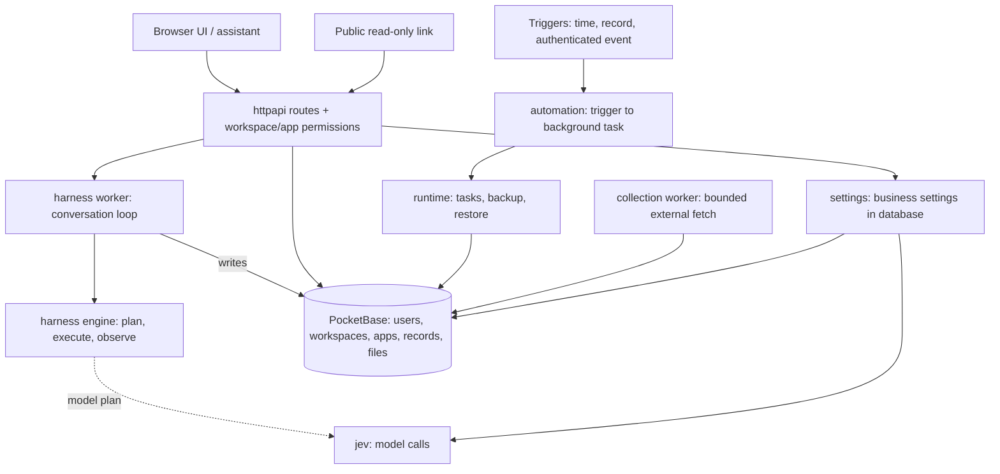

# Architecture

Dependency direction is downward only. Verified from Go imports, not from intent.

```
main.go (serve|version|backup|restore|admin-grant)
   │
L2  httpapi        routes, agent sessions, permissions, automation, public site
   │   imports every package below
L1  api ──► settings ──► jev, pocketbase
   │        runtime ─────────► pocketbase
L0  pocketbase     embedded PocketBase 0.40.4, migrations, data directory
    jev            AI credential and model service client
    harness        generic agent loop engine (plan→execute→observe), zero business imports
```

- The three L0 packages never import each other.
- `harness` is the only package with no business dependency. It takes Store, PlanFunc, and ExecuteFunc by injection.
- `httpapi` is the only top package. Nothing below it imports it.

## Runtime flow



- The assistant needs model credentials through jev. Deterministic CRUD works without them.
- Collection scripts fetch external HTTP(S) inside bounded runs with budgets and idempotent receipts.
- Triggers create background tasks in runtime. Permissions stay server-side.

## Layering rule

One rule covers the whole tree: a package may import only packages below its layer. The current code satisfies it. `httpapi` is large (60+ files) but already split by subdomain prefix: `routes_*`, `harness_*`, `collection_*`, `public_*`. Split those prefixes into subpackages only when a subdomain needs its own tests or parallel work. Until then, the split buys nothing.
